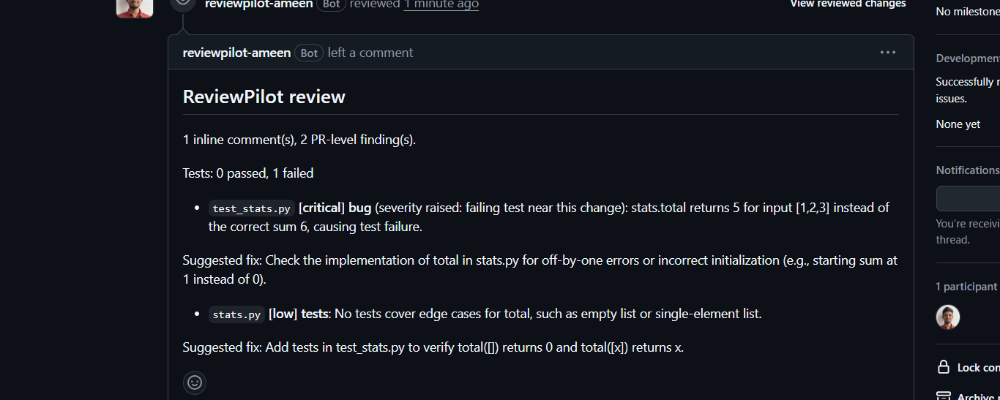
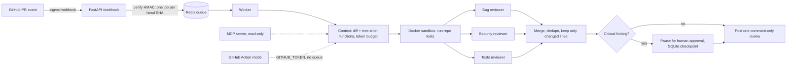

# ReviewPilot

An AI code reviewer for pull requests. Three specialist reviewers (bug, security, tests) read each
changed file with its surrounding code, and one comment-only review lands on the PR: inline comments
on the changed lines plus a summary. Runs as a self-hosted GitHub App, a GitHub Action, or an MCP
server. 100% free: Groq free tier, local Docker, no hosting.




## How it works



LLM: Groq `openai/gpt-oss-120b` (bug, security) and `gpt-oss-20b` (tests). Per-file prompts, cached
replies, retries on 429, token count logged per PR.

## Evaluation

Planted-bug PRs in a small sample repo; ground truth comes from the planting script, never from the
model. A bug counts as detected if a finding lands in the right file within +/-2 lines. Ambiguous
matches were checked by hand (`eval/results/*/manual_review.json`). Missing-tests notes are counted
apart from false positives.

### Headline: held-out set (10 PRs: 8 bug, 2 clean)

These PRs were not used to find the problems or design the fixes below, so this is the honest number.

| Metric | Result |
|---|---|
| Detection rate | **0.875** (7 of 8; miss is a resource leak) |
| Category accuracy (right reviewer) | 1.0 |
| Code false positives per PR, bug / clean PRs | 0.38 / 0.5 |
| Missing-tests notes per PR, bug / clean PRs | 0.88 / 0.5 |
| Tokens per PR, mean / p95 | 2729 / 4180 |
| Latency per PR, mean / p95 | 9.8 s / 18.09 s |

Ten PRs is a tiny sample: one PR moves detection by 12.5 points and the false-positive rates are
noise-level (3 findings in 8 bug PRs, 1 in 2 clean PRs).

### Improvement story: original set (50 PRs: 40 bug, 10 clean)

The error analysis of the first run (`docs/ERROR_ANALYSIS.md`) drove three fixes: stop echoing
findings on test files, give the tests reviewer the test files' content, and add concurrency to the
bug prompt. Both columns are real runs with fresh caches. This set was used to find the problems, so
read it as before/after, not as a generalisation claim.

| Metric | Before | After |
|---|---|---|
| Detection rate | 0.925 | 0.975 |
| Code FP per PR, bug / clean PRs | 0.10 / 0.10 | 0.12 / 0.0 |
| Missing-tests notes per PR, bug / clean | 0.9 / 1.1 | 0.68 / 0.5 |
| Test-file echoes | 4 | 0 |
| Code findings misfiled in the summary | 4 | 0 |
| Race-condition PRs detected | 4/5 | 5/5 |
| Tokens per PR, mean / p95 | 2527 / 4982 | 2452 / 4240 |
| Latency per PR, mean / p95 | 8.0 s / 16.28 s | 9.6 s / 18.91 s |

The fixes did not move the held-out set: detection stayed 7/8, and its code false positives rose
slightly (bug PRs 0.25 to 0.38; 1 more finding, within noise). Sources: `eval/results/summary.json` (before), `eval/results/after/`, `eval/results/heldout_before/`.

## Safety design

- **PR content is data.** Code, titles, comments and file names go into the prompts as untrusted input.
  The only output action is posting a review: it cannot push, merge, approve, request changes or edit settings.
  Reviews are always `COMMENT`.
- **Minimum permissions.** GitHub App: Pull requests read/write, Contents read, Metadata read.
  The Action asks for `contents: read` and `pull-requests: write`.
- **Sandboxed tests.** Repo tests run only in Docker: no network, non-root, read-only source mount,
  CPU/memory/time limits, no secrets inside. PR code never runs on the host. See `docs/SANDBOX.md`.
- **Signed webhooks.** HMAC SHA-256 checked on every request; unsigned or wrong ones are rejected.
- **Idempotent.** One job per PR head commit; a hidden marker in the review body stops a second post.
- **Human in the loop.** Critical findings pause the graph (SQLite checkpoint, survives a worker kill)
  until approved or rejected.
- **Size limits.** Huge PRs, binary, generated and lock files are skipped and listed in the summary.
- **Read-only MCP.** No MCP tool posts to GitHub (`docs/MCP.md`).

## Known limits

- **No hosting.** The App mode needs your own machine running (webhook forwarding, Redis, worker).
  Action mode needs none, but has no approval pause and no sandbox.
- **No repo dependencies in the sandbox.** It has no network, so tests that need packages the image
  lacks will fail in the sandbox, which is not a verdict on the PR.
- **Toy eval repo.** All 60 eval PRs are small, single-purpose changes on one purpose-built repo.
  Real PRs are larger and noisier. Logic and off-by-one bugs state the intended behaviour in a
  docstring, planted secrets are obviously fake.
- **Path-traversal false positives on file code.** The bug reviewer flags "opens a caller-given path"
  on resource-leak code instead of the missing `close()`. It caused the remaining resource-leak misses
  (rl5 and h07) and false positives on others. Open issue.
- **Fork PRs are not reviewed in Action mode.** GitHub gives fork PRs a read-only token and no
  secrets. The usual workaround, `pull_request_target`, runs with secrets next to untrusted PR content,
  so it is deliberately not used.
- One Groq free-tier model family, temperature 0, one run per eval; Groq limits are about 8K
  tokens/min and 200K tokens/day per model.
- Python only (tree-sitter-python).

## Run locally (Windows, PowerShell)

Needs Python 3.12, [uv](https://docs.astral.sh/uv/), Docker Desktop, and a free
[Groq key](https://console.groq.com/keys).

```powershell
git clone https://github.com/Ameen195/reviewpilot; cd reviewpilot
uv sync
copy .env.example .env        # fill in GROQ_API_KEY and the GitHub App values
uv run pytest -q              # offline tests, no network or LLM
uv run ruff check .
```

Full App mode (GitHub App setup, smee.io forwarding): `docs/GITHUB_APP_SETUP.md`. Then, in three terminals:

```powershell
docker compose up -d                                   # Redis
docker build -t reviewpilot-sandbox:latest src/reviewpilot/sandbox
uv run uvicorn reviewpilot.api.app:app --port 8000     # webhook + approval page
uv run python -m reviewpilot.queue.worker              # worker
```

Print-only review of one PR (posts nothing): `uv run python -m reviewpilot.agents.graph owner/repo 12`.
Re-run the evaluation: `uv run python eval/run.py --set heldout --out <dir>`
(options in `eval/run.py`). MCP server for Claude Code or Desktop: `docs/MCP.md`.

## Try the GitHub Action

1. Add a `GROQ_API_KEY` repo secret (Settings > Secrets and variables > Actions).
2. Copy `docs/example-workflow.yml` to `.github/workflows/reviewpilot.yml` in your repo.
3. Open a PR from a branch of the same repo. The review appears within a minute or two.

**Tested:** verified on a real PR in a separate test repo (PR #6). The review posted in 26 s, flagged
the hardcoded API key as a high-severity security finding on line 1, and added a missing-tests note
to the summary. One PR, one run: a smoke test, not an evaluation.

The Action installs this project on the runner and uses the workflow's own `GITHUB_TOKEN`; your key
goes only to Groq.
